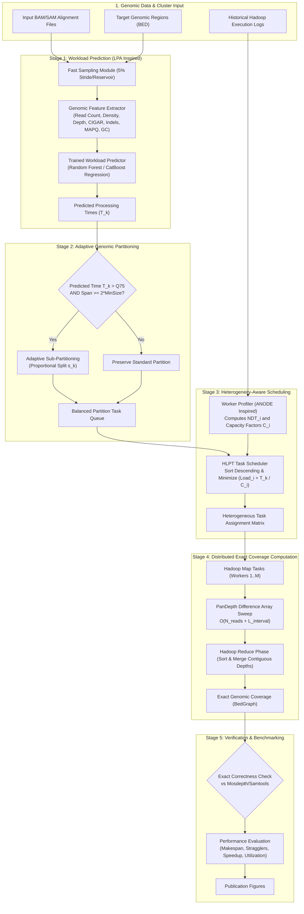
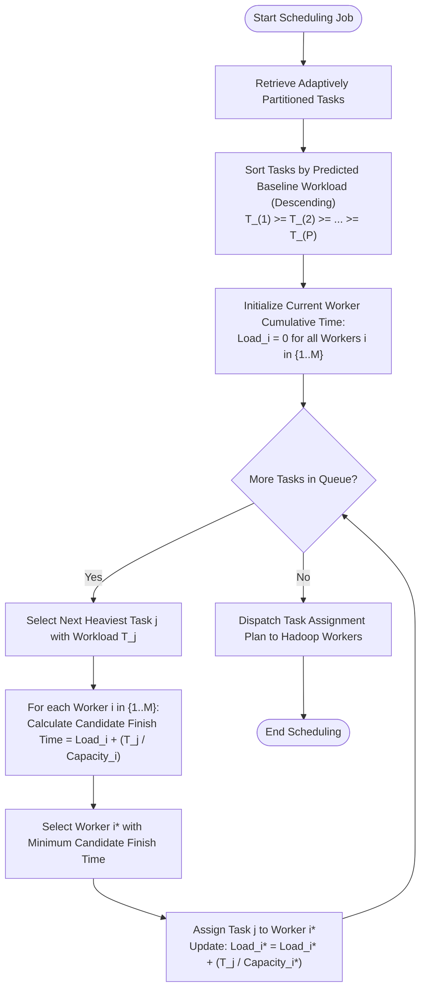
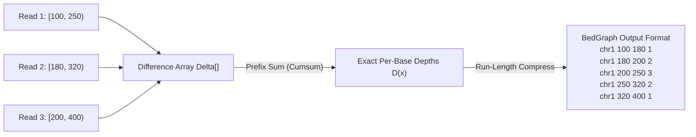

# System Architecture & Methodology Diagrams

## 1. End-to-End System Architecture

---

## 2. HLPT Task Scheduling Decision Flowchart

---

## 3. Difference Array Line Sweep for Exact BAM Coverage

